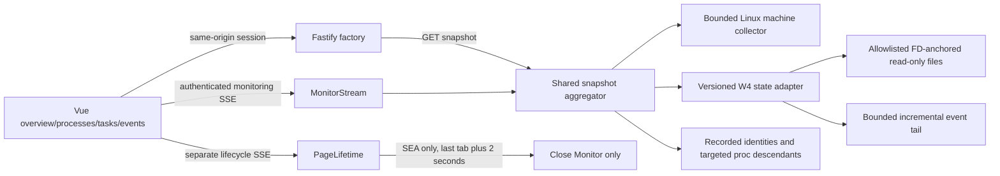

# Architecture — M0 foundation with M1 observation

The supplied company standard remains authoritative. One ESM TypeScript project contains a Fastify factory, Vue 3 SPA, shared DTO/config contracts and TypeScript tooling. Backend/frontend depend on shared code, never each other. M0 startup, identity/port derivation, security, asset embedding, lifecycle and native SEA behavior remain intact.

`main.ts` owns env/CLI validation, browser launch, second-instance handling and signals. `server.ts` composes focused security, lifecycle, monitoring and asset modules. All mutable backend state is per factory/collector/stream instance. No Worker implementation is imported or executed.

`Monitor` shares an in-flight collection and cadence cache across snapshot requests and every SSE subscriber. Machine and Worker reads begin together; recorded identities feed the process collector, then health is derived from verified liveness/freshness. Task/checkpoint/scheduling data has an independent slower cache. Collector failures are sanitized typed partial states. Completed snapshots have schema version, revision, UTC timestamp, per-source read/source timestamps and availability. Source fields preserve M0's `lastSuccessfulAt` naming and add age/live-identity metadata.

`MonitorStream` reserves at most 32 clients, sends headers and a full initial snapshot before adding each client to the ready-to-broadcast set, and runs one shared polling loop and heartbeat timer while subscribers exist. This prevents a subscriber joining an in-flight collection from receiving an implicit unprotected response before its SSE headers. Envelopes include sequence, per-server UUID, timestamp and snapshot. Reconnect always receives a full snapshot rather than a replay. Output queues are capped at 4 MiB/client, no application-side event queue accumulates, disconnected/broken writers are removed, and all timers stop with the last subscriber or server shutdown. Diagnostics expose subscriber/cycle/limit information through authenticated snapshots.

The Vue composable bootstraps via the M0 lifecycle session, fetches an initial snapshot and subscribes to monitoring SSE. Native EventSource retries connections; each reconnection resynchronizes completely. Sequence/revision checks reject duplicates and stale frames; a new server UUID resets ordering. Lifecycle restart bootstrap refreshes cookies. A small UI clock updates age independently, showing stale data even if transport stalls. No periodic frontend snapshot polling remains. Filters, selection, tabs, tree collapse and refresh are display-only.

Security checks run before route handlers, using the matched route and decoded URL so encoded API prefixes cannot bypass authentication: loopback Host allowlist, exact Origin when supplied, rejected cross-/same-site API fetches, per-start HttpOnly Strict session, no-store/nosniff/referrer/resource headers and strict production CSP. Early router failures receive the same hardening. Health and session bootstrap expose no machine/Worker data. The monitoring and lifecycle streams both require the cookie; no tokens go in URLs. Assets are an embedded map and SPA fallback is restricted to extensionless navigation.

Worker IO is explicit, read-only, bounded and separated from Worker locks/config/transcripts. Linux no-follow/nonblocking opens through pinned directory handles prevent symlink and directory-replacement escapes. Regular-file and hard-link checks, JSON nesting/size limits and per-cycle budgets contain malformed external state. Worker health never treats persisted BUSY as proof of a live process. See the compatibility document for source versions, projection rules, limits and polling caveats.

The machine collector retains M0's proc delta/available-memory calculations. Process tick/page constants come from local `self/auxv`; boot identity from `sys/kernel/random/boot_id`; process stat parsing handles parentheses/spaces. Only recorded identities and known descendants are inspected. No environment, full command-line, global open-file or global proc scan is performed.

Vite builds the SPA; build tooling emits a URL/MIME/base64 map and redirects the placeholder module during esbuild bundling to CommonJS targeting Node 22. Native Linux packaging copies the current Node runtime and injects its matching SEA blob with postject. SEA's dedicated bundle bakes last-tab shutdown true; ordinary Node/Docker bundles keep false. A separate lifecycle stream controls this, never the monitoring subscriber count.

Docker uses a full-source/test build stage and a non-root Node 22 Alpine runtime containing only `server.cjs`. Compose is generated from shared identity/ports and publishes to host loopback. It requires no privileged mode, mounts, database or host PID access, and makes no full-host-observation promise.
